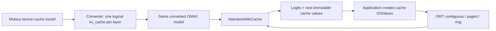

# End-to-end walkthrough: logical KV caches, runtime-owned storage

This example exports pretrained Mobius decoder graphs, converts each layer's
tensor K/V plumbing to the experimental ONNX `kv_cache` type and
`AttentionWithCache` operator, then compares the original and converted graphs
on CPU. **The model defines logical attention and history; the runtime chooses
physical storage.** Switching contiguous, paged, or ring storage does not change
the serialized converted model.

This page follows the change through the model, ONNX Runtime (ORT), and the
application, with real implementation excerpts and measured pretrained results.
The [reproduction appendix](#appendix-c-dependencies-and-builds) contains the
source pins, local wheel locations, build prerequisites, and commands. This is a
CPU float32 correctness prototype, not a production serving stack or an adopted
ONNX standard: its dedicated type requires experimental IR 15 and opset 29.



## 1. Change the model contract, not the learned computation

The original model accepts separate past-key and past-value tensors for every
layer and returns their extended tensors. The converted model instead accepts
one dedicated `TypeProto.kv_cache_type` value per layer and returns its successor.
This abstract, runtime-owned value is not a tensor encoding of a page table,
and it is not the unrelated `TypeProto.opaque_type`.

| Per-layer contract | Inputs to attention | Outputs |
| --- | --- | --- |
| Before | Q, K-new, V-new, mask, past-key tensor, past-value tensor | Y, present-key tensor, present-value tensor |
| After | Q, K-new, V-new, cache value, mask, absolute positions | Y, next cache value |

[The converter](convert_to_kv_cache.py) retains projections, Qwen3's Q/K
normalization, RoPE, head mapping, masks, and causal semantics. It reshapes the
original flat Q/K/V into BNSD for `AttentionWithCache`. Cache type metadata
describes logical batch/head geometry, element type, and sliding window, not
physical pages or ring slots. Qwen has 28 full-attention layers; Gemma has
15 local layers with a 512-token window and 3 full-attention layers.

The input mask still describes the complete logical token history. Positions
continue increasing even when a ring drops physical entries. For example, a
Gemma local layer at computed end 524 retains positions `[12,524)`, not
positions relabeled as `[0,512)`. Its full-attention layers retain from 0.
The [graph appendix](#appendix-b-graph-transformation-details) lists exact
graph signatures and node inventories.

## 2. What changes inside ONNX Runtime?

The following are real excerpts from executable code commit
`11a522b835ee41b53c6d293a35c7c7135e2dfd5d`, not proposed APIs or pseudocode.
Links include immutable commit IDs and line ranges; `// ...` marks omitted
source where an excerpt is abbreviated. They are included here so the runtime
change can be understood without separately reading another repository.

### A storage-independent interface and value lifetime

The runtime exposes logical `Begin()`/`End()` positions and visits borrowed
blocks with absolute positions and head strides. Attention need not know
whether those blocks come from one contiguous allocation, immutable pages, or
a wrapped ring. From
[`kv_cache.h`, lines 38-57](https://github.com/microsoft/onnxruntime/blob/11a522b835ee41b53c6d293a35c7c7135e2dfd5d/include/onnxruntime/core/framework/kv_cache.h#L38-L57):

```cpp
class KVCache {
 public:
  virtual ~KVCache() = default;
  virtual const KVCacheOptions& Options() const noexcept = 0;
  virtual int64_t End() const noexcept = 0;
  virtual int64_t Begin() const noexcept = 0;
  virtual void Visit(const std::function<void(const KVCacheBlock&)>& visitor) const = 0;

  // Append returns a private, untrimmed version: all queries in a chunk can still
  // see their required history. Seal performs retention only after attention.
  virtual std::shared_ptr<const KVCache> Append(gsl::span<const float> keys,
                                                gsl::span<const float> values,
                                                int64_t tokens) const = 0;
  virtual std::shared_ptr<const KVCache> Seal() const = 0;
};

// OrtValues share immutable backing, never mutable per-layer published state.
struct KVCacheValue {
  std::shared_ptr<const KVCache> cache;
};
```

An `OrtValue` owns this shared immutable payload. `Append` creates private
staging state instead of mutating the caller's cache. Paged append shares
unchanged committed pages; a committed ring owns exactly the window's slots
per head, addressed by absolute position modulo window size. The entire new
chunk is staged before retention so its earliest queries do not lose required
history when a chunk crosses the window boundary.

| Backend selected by the application | Physical implementation | Logical behavior |
| --- | --- | --- |
| `contiguous` | Contiguous retained K/V rebuilt on append | Full history or configured sliding window |
| `paged` | Shared immutable committed pages plus new pages | Same logical history/window |
| `ring` | Bounded committed window bank; private chunk staging | Sliding-window layers only |

Bounded committed ring storage does not mean zero temporary allocation.
This demo makes no measured memory or throughput claim.

### Attention streams over storage; it does not gather dense KV

The CPU kernel calls `staged->Visit(...)` and reads keys/values directly from
each block. It uses absolute positions for causal/window filtering and mask
lookup, grouped-query head mapping for K/V heads, and the original scale and
softcap semantics. Within that visitor, the online softmax update is
[`attention_with_cache.cc`, lines 149-157](https://github.com/microsoft/onnxruntime/blob/11a522b835ee41b53c6d293a35c7c7135e2dfd5d/onnxruntime/core/providers/cpu/llm/attention_with_cache.cc#L149-L157):

```cpp
              const double next_maximum = std::max(maximum, score);
              const double correction = std::exp(maximum - next_maximum);
              const double weight = std::exp(score - next_maximum);
              normalizer = normalizer * correction + weight;
              for (int64_t d = 0; d < o.value_head_size; ++d) {
                accumulator[static_cast<size_t>(d)] =
                    accumulator[static_cast<size_t>(d)] * correction + weight * value[d];
              }
              maximum = next_maximum;
```

This keeps a running maximum, normalizer, and weighted-value accumulator
instead of materializing a dense KV gather or a full attention-score matrix.
The [surrounding loop, lines 126-169](https://github.com/microsoft/onnxruntime/blob/11a522b835ee41b53c6d293a35c7c7135e2dfd5d/onnxruntime/core/providers/cpu/llm/attention_with_cache.cc#L126-L169)
shows block visitation, masks, window checks, and final normalization. Only
after attention finishes does the kernel seal retention and publish its output
([lines 167-168](https://github.com/microsoft/onnxruntime/blob/11a522b835ee41b53c6d293a35c7c7135e2dfd5d/onnxruntime/core/providers/cpu/llm/attention_with_cache.cc#L167-L168)):

```cpp
    auto next = staged->Seal();
    ctx->Output<KVCacheValue>(1)->cache = std::move(next);
```

This is functional old-state safety: if this node or a later node fails, the
caller's input caches remain unchanged. The application advances its cache
references only after a successful run. ORT also rejects preallocated cache
fetch objects, preventing output reuse from overwriting caller-owned state.

### Registration, validation, and Python are part of the change

The prototype is not just a new kernel. ORT registers `KVCacheValue` as a
dedicated non-tensor type, recognizes its geometry in graph type handling,
validates cache feeds against the graph contract, and registers the
opset-29 CPU attention/create/describe/export kernels. The Python factory
constructs the same native value rather than a Python-side tensor substitute.
From
[`onnxruntime_pybind_ortvalue.cc`, lines 23-28](https://github.com/microsoft/onnxruntime/blob/11a522b835ee41b53c6d293a35c7c7135e2dfd5d/onnxruntime/python/onnxruntime_pybind_ortvalue.cc#L23-L28):

```cpp
std::unique_ptr<OrtValue> CreatePythonKVCache(int64_t batch, int64_t heads, int64_t key_width, int64_t value_width,
                                            const std::string& backend, int64_t page_size, int64_t window) {
  auto value = std::make_unique<OrtValue>();
  CreateKVCacheOrtValue({batch, heads, key_width, value_width, ParseKVCacheStorage(backend), page_size, window}, *value);
  return value;
}
```

The exact implementation map is below; these links are optional deeper reading,
not prerequisites for following the walkthrough.

| ORT surface | Immutable source and purpose |
| --- | --- |
| Cache abstraction and lifetime | [`kv_cache.h:29-57`](https://github.com/microsoft/onnxruntime/blob/11a522b835ee41b53c6d293a35c7c7135e2dfd5d/include/onnxruntime/core/framework/kv_cache.h#L29-L57): borrowed blocks, interface, immutable payload |
| Storage | [`kv_cache.cc:118-179`](https://github.com/microsoft/onnxruntime/blob/11a522b835ee41b53c6d293a35c7c7135e2dfd5d/onnxruntime/core/framework/kv_cache.cc#L118-L179): paged sharing, retention, ring layout |
| Type registry | [`data_types.cc`](https://github.com/microsoft/onnxruntime/blob/11a522b835ee41b53c6d293a35c7c7135e2dfd5d/onnxruntime/core/framework/data_types.cc): dedicated `KVCacheType`, not the opaque-type fallback |
| Graph typing | [`graph.cc`](https://github.com/microsoft/onnxruntime/blob/11a522b835ee41b53c6d293a35c7c7135e2dfd5d/onnxruntime/core/graph/graph.cc): cache type propagation/compatibility |
| Session validation | [`inference_session.cc:3441-3445`](https://github.com/microsoft/onnxruntime/blob/11a522b835ee41b53c6d293a35c7c7135e2dfd5d/onnxruntime/core/session/inference_session.cc#L3441-L3445) and [`3537-3542`](https://github.com/microsoft/onnxruntime/blob/11a522b835ee41b53c6d293a35c7c7135e2dfd5d/onnxruntime/core/session/inference_session.cc#L3537-L3542): reject preallocated cache fetches; validate feed geometry |
| CPU attention and registrations | [`attention_with_cache.cc`](https://github.com/microsoft/onnxruntime/blob/11a522b835ee41b53c6d293a35c7c7135e2dfd5d/onnxruntime/core/providers/cpu/llm/attention_with_cache.cc): streaming kernel and CPU registrations |
| Native Python methods | [`onnxruntime_pybind_ortvalue.cc:128-132`](https://github.com/microsoft/onnxruntime/blob/11a522b835ee41b53c6d293a35c7c7135e2dfd5d/onnxruntime/python/onnxruntime_pybind_ortvalue.cc#L128-L132): factory/inspection binding |
| Public Python wrapper | [`onnxruntime_inference_collection.py:1299-1324`](https://github.com/microsoft/onnxruntime/blob/11a522b835ee41b53c6d293a35c7c7135e2dfd5d/onnxruntime/python/onnxruntime_inference_collection.py#L1299-L1324): `OrtValue.kv_cache` and inspection |

## 3. Application: create, feed, fetch, repeat

[The runnable driver](run_example.py) creates one cache value per layer,
choosing the backend at allocation time. Its real creation code is:

```python
            ort.OrtValue.kv_cache(
                1,
                num_kv_heads,
                head_dim,
                head_dim,
                backend=_cache_backend(backend, window),
                page_size=_PAGE_SIZE,
                sliding_window=window,
            )
```

For `mixed`, `_cache_backend` selects `paged` for full-attention layers and
`ring` for sliding layers. After preparing token/mask/absolute-position tensor
feeds, the driver's `_run_kv_cache` uses the ordinary OrtValue run path:

```python
    feeds.update({_KV_CACHE_INPUT.format(layer=i): cache for i, cache in enumerate(caches)})
    output_names = ["logits"] + [_KV_CACHE_OUTPUT.format(layer=i) for i in range(len(caches))]
    outputs = session.run_with_ort_values(output_names, feeds)
    return outputs[0].numpy(), outputs[1:]
```

Only logits are converted to NumPy. Cache outputs stay native OrtValues and
become the next invocation's inputs. At each step the driver compares all
logits against the original tensor-cache model, checks the next greedy token,
and checks both old and new caches' computed/retained positions. This tests
functional transitions, not merely constructor success. After installing the
matching builds and generating artifacts as described in the appendices, run:

```powershell
python examples\kvcache\run_example.py --model Qwen/Qwen3-0.6B --model-dir C:\models\qwen3-0.6b
python examples\kvcache\run_example.py --model google/gemma-3-270m --model-dir C:\models\gemma-3-270m --prefill-chunks 500,24,3
```

## 4. Observed pretrained results: same graph, different storage

All rows compare full logits with the original tensor-cache graph at
`atol=rtol=1e-4`; all next-token greedy checks matched. These are CPU float32
correctness measurements, not throughput or peak-memory benchmarks.

| Checkpoint | Runtime storage | Prefill + decode | Maximum absolute logit error | Generated token IDs |
| --- | --- | --- | --- | --- |
| Qwen3-0.6B | contiguous | 8 + 3 single-token steps | `9.6321106e-5` | `[5562,13,576]` |
| Qwen3-0.6B | paged | Same | `9.6321106e-5` | Same |
| Gemma 3-270M | contiguous | 500,24,3 + 3 single-token steps | `5.531311e-5` | `[506,31770,4799]` |
| Gemma 3-270M | paged | Same | `5.531311e-5` | Same |
| Gemma 3-270M | mixed: paged full / ring local | Same | `5.531311e-5` | Same |

Each checkpoint uses one converted file, loaded by the same session for all
its backends, with these SHA256 hashes from the persisted reports:

| Converted model | Backends sharing this exact graph | SHA256 |
| --- | --- | --- |
| Qwen3-0.6B | contiguous, paged | `b638538806455dedcc653a1c28405169f6874558f066fcfd8a22e82abc0bfc63` |
| Gemma 3-270M | contiguous, paged, mixed | `30a252f32b5c434fb2bd88ac5c59955abe94131e3cd910dbb7500556a18679df` |

The Gemma mixed run crosses the sliding boundary inside the second chunk:

| Chunk | Computed end (all layers) | Local ring retained range | Full-attention retained range |
| --- | --- | --- | --- |
| 500 tokens | 500 | `[0,500)` | `[0,500)` |
| 24 tokens | 524 | `[12,524)` | `[0,524)` |
| 3 tokens | 527 | `[15,527)` | `[0,527)` |

Three decode steps then advance the end to 530, with local retained begin 18
and full retained begin 0. Qwen's end advances 8,9,10,11 with retained begin 0;
Qwen multi-chunk prefill was not tested. Generated text is ` dog. The` for
Qwen and ` the lazy dog` for Gemma. Report paths, per-step errors, and
reproducibility details follow.

## Appendix A: models and artifact access

Source branches are published, but the verified wheels, model binaries, and
reports listed here are local artifacts, not hosted downloads. A reader needs
access to those files or must build the pinned forks and export the checkpoints.
Checkpoint access is subject to Hugging Face permissions/license terms; normal
authentication is required if access is gated. The scripts reuse the local
Hugging Face cache rather than intentionally downloading duplicate weights.
Commands assume Windows and a suitable Python development environment; there
is no one-command-from-the-internet setup.

| Model | Hugging Face revision | Attention layout |
| --- | --- | --- |
| `Qwen/Qwen3-0.6B` | `c1899de289a04d12100db370d81485cdf75e47ca` | 28 full-attention layers |
| `google/gemma-3-270m` | `9b0cfec892e2bc2afd938c98eabe4e4a7b1e0ca1` | 15 sliding-window layers (`W=512`), 3 full-attention layers |

The generated files from the verified model build are outside the repository
under:

```text
C:\Users\grama\.copilot\session-state\5be4db02-3ca8-4dea-8bfb-45ac0a0d6d9f\files\kvcache\
  qwen3-0.6b\model.onnx
  qwen3-0.6b\model.onnx.data
  qwen3-0.6b\model.kv_cache.onnx
  qwen3-0.6b\config.json
  qwen3-0.6b\run_results.json
  gemma-3-270m\model.onnx
  gemma-3-270m\model.onnx.data
  gemma-3-270m\model.kv_cache.onnx
  gemma-3-270m\config.json
  gemma-3-270m\run_results.json
```

The `.data` files contain the pretrained weights and are intentionally not
checked in. The build script pins both model revisions, uses Mobius's
unfused/default execution-provider path, saves the external weights, and
validates the baseline and converted graphs. Hugging Face's normal cache is
used, so existing checkpoint files are reused. Recreate artifacts in a chosen
directory with:

```powershell
python examples\kvcache\build_model.py --model Qwen/Qwen3-0.6B --output-dir C:\models\qwen3-0.6b
python examples\kvcache\build_model.py --model google/gemma-3-270m --output-dir C:\models\gemma-3-270m
```

## Appendix B: graph transformation details

The baseline graphs use ONNX `Attention` (default-domain opset 24) with flat
`BS(H*D)` Q/K/V inputs. Qwen3 has 28 Attention nodes and Gemma 3 has 18. Their
serialized graph signatures are:

| Graph | Inputs | Outputs |
| --- | --- | --- |
| Baseline (Qwen 59 / Gemma 39) | `input_ids`, `attention_mask`, `position_ids`, and `past_key_values.<layer>.key` / `.value` for every layer | `logits`, and `present.<layer>.key` / `.value` for every layer (Qwen 57 / Gemma 37) |
| Converted (Qwen 31 / Gemma 21) | `input_ids`, `attention_mask`, `position_ids`, and `past_cache_<layer>` for every layer | `logits` and `present_cache_<layer>` for every layer (Qwen 29 / Gemma 19) |

The converter replaces each tensor-cache pair with one abstract,
runtime-owned cache value input and output per layer, converts Q/K/V to the
operator's BNSD layout, and preserves the original mask, absolute positions,
projections, Qwen3's Q/K normalization, RoPE, grouped-query head mapping,
causal semantics, and per-layer attention geometry.
The external `attention_mask` is the original INT64 logical token mask with
shape `[B,past_tokens + query_tokens]`. The graph constructs the rank-4
Attention mask from it: BOOL for Qwen3 and FLOAT additive bias for Gemma 3;
both use the complete logical key length on the last axis, independent of the
sliding cache's retained storage.

The converted models use default-domain opset 29 and IR version 15. Each cache
carries batch, KV-head, key/value head-size, element-type, and sliding-window
metadata. The nodes are
`AttentionWithCache(Q_new, K_new, V_new, cache, attention_mask, positions) ->
(Y, cache_next)`. Qwen uses `sliding_window=0` for all layers. Gemma uses
`sliding_window=512` for its 15 local-attention layers and `0` for its 3
global-attention layers.

Complete node inventories from the serialized graphs are listed below. The
default ONNX domain is written as `ai.onnx`; the model-local Microsoft
normalization function remains in `com.microsoft`.

| Model | Baseline graph, 574 / 532 nodes |
| --- | --- |
| Qwen3-0.6B | `Attention=28, Cast=1, Concat=1, Expand=1, Gather=3, MatMul=197, Mul=28, RMSNormalization=57, Reshape=112, RotaryEmbedding=56, Shape=3, Swish=28, Transpose=1, Unsqueeze=2, com.microsoft::SkipSimplifiedLayerNormalization=56` |
| Gemma 3-270M | `Add=109, And=3, Attention=18, Cast=1, CumSum=1, Gather=5, Gelu=18, GreaterOrEqual=1, Less=1, MatMul=127, Mul=19, RMSNormalization=73, Reshape=72, RotaryEmbedding=36, Shape=2, Slice=1, Sub=2, Unsqueeze=5, Where=2, com.microsoft::SkipSimplifiedLayerNormalization=36` |

| Model | Converted graph, 798 / 676 nodes |
| --- | --- |
| Qwen3-0.6B | `AttentionWithCache=28, Cast=1, Concat=1, Expand=1, Gather=3, MatMul=197, Mul=28, RMSNormalization=57, Reshape=224, RotaryEmbedding=56, Shape=3, Swish=28, Transpose=113, Unsqueeze=2, com.microsoft::SkipSimplifiedLayerNormalization=56` |
| Gemma 3-270M | `Add=109, And=3, AttentionWithCache=18, Cast=1, CumSum=1, Gather=5, Gelu=18, GreaterOrEqual=1, Less=1, MatMul=127, Mul=19, RMSNormalization=73, Reshape=144, RotaryEmbedding=36, Shape=2, Slice=1, Sub=2, Transpose=72, Unsqueeze=5, Where=2, com.microsoft::SkipSimplifiedLayerNormalization=36` |

Conversion intentionally fails closed if cache tensors are consumed outside
their layer's Attention node, diagnostic Attention outputs are present, head
geometry is inconsistent, or an unsupported Attention attribute would be
lost. The protobuf-level rewrite is isolated in `convert_to_kv_cache.py`
because the experimental cache type is not yet representable through the
stable ONNX IR API.

## Appendix C: dependencies and builds

The graph conversion requires the experimental ONNX API from
`gramalingam/onnx` commit
`4443045c53d13a8d3157fcbd2cd5e52450a0784b` (including
`helper.make_kv_cache_type` and the opset-29 `AttentionWithCache` schema).
The verified CPython 3.12+ Windows wheel is stored outside the repository at
`C:\Users\grama\.copilot\session-state\51a9868f-d303-40e4-8e9f-da4e7b7a935b\files\onnx-1.24.0-cp312-abi3-win_amd64.whl`
(SHA256
`03029ba7a488ee71bc1ad2f4647a695097e1eca95fb56000e52c89218482f744`).
Install it with:

```powershell
python -m pip install "C:\Users\grama\.copilot\session-state\51a9868f-d303-40e4-8e9f-da4e7b7a935b\files\onnx-1.24.0-cp312-abi3-win_amd64.whl"
```

It was built in Release with Visual Studio 2022 CMake 3.31.6; plain editable
installation is not verified on Windows. The ONNX and ONNX Runtime commits
used below are published on the `gramalingam-kvcache` branches of
`https://github.com/gramalingam/onnx.git` and
`https://github.com/microsoft/onnxruntime.git`, respectively. The commands
clone those branches and check out pinned commits for reproducibility.

To reproduce that Release wheel from the pinned source checkout, ensure CMake
3.31.6 is on `PATH`, map the checkout to a short drive to avoid MSBuild's
260-character path limit, then run:

```powershell
git clone --branch gramalingam-kvcache https://github.com/gramalingam/onnx.git C:\src\onnx-kvcache
Set-Location C:\src\onnx-kvcache
git checkout 4443045c53d13a8d3157fcbd2cd5e52450a0784b
subst K: C:\src\onnx-kvcache
Set-Location K:\
python -m pip wheel . --no-deps --wheel-dir K:\.setuptools-cmake-build-kvcache-release\wheelhouse `
  --config-settings=build-dir=K:\.setuptools-cmake-build-kvcache-release `
  --config-settings=cmake.define.ONNX_BUILD_CUSTOM_PROTOBUF=ON `
  --config-settings=cmake.define.FETCHCONTENT_TRY_FIND_PACKAGE_MODE=NEVER `
  --config-settings=cmake.define.CMAKE_CONFIGURATION_TYPES=Release `
  --config-settings=cmake.define.CMAKE_MSVC_RUNTIME_LIBRARY=MultiThreadedDLL
```

The native ONNX Runtime fork can be built from its source pin with CPython
3.13, Visual Studio 2022 C++ tools/Windows SDK, Git, CMake, and Ninja available:

```powershell
git clone --branch gramalingam-kvcache https://github.com/microsoft/onnxruntime.git C:\src\onnxruntime-kvcache
Set-Location C:\src\onnxruntime-kvcache
git checkout f72121a57a33779cf8ce6161314bb7dd32d90e30
python -m venv .venv
.\.venv\Scripts\Activate.ps1
python -m pip install cmake ninja
python tools\kvcache\build.py --onnx-source C:\src\onnx-kvcache
```

The wrapper checks out the pinned ONNX source into its private build tree,
builds Release with source Protobuf and contrib kernels enabled, and produces
the native test executable and Python wheel. The pinned runtime checkout
`f72121a57a33779cf8ce6161314bb7dd32d90e30` adds documentation only over the
verified executable source revision recorded below. To run the cache unit
suite from the Release output directory:

```powershell
Set-Location build\kvcache-native\Release\Release
.\onnxruntime_kvcache_test.exe --gtest_filter=KVCacheTest.*
```

The verified build used MSVC 14.44.35207, Windows SDK 10.0.26100, CMake 4.4.3,
and two parallel jobs. Its source revision and wheel hash are recorded below.
Install the compatible ONNX and ORT wheels together with
`python -m pip install --force-reinstall <onnx-wheel> <ort-wheel>`.

Mobius itself can be installed in development mode with
`pip install -e ".[transformers,testing]"`.

Use the matching experimental ONNX and ONNX Runtime builds for default-domain
opset 29 and native `AttentionWithCache` support. The native runtime source pin
is `microsoft/onnxruntime` commit
`11a522b835ee41b53c6d293a35c7c7135e2dfd5d` (parent
`31d93935030587d7c362d4e13b00fa5943db851a`). It registers the required
Cast-28 and Swish-24 kernels. The verified CPU-only CPython 3.13 wheel is
`C:\repos\copilot-worktrees\onnxruntime\gramalingam-cuddly-adventure\build\kvcache-native\Release\Release\dist\onnxruntime-1.32.0-cp313-cp313-win_amd64.whl`
(SHA256
`ab1fc5ef214e69ce17ee566fec58ffe1a4a8bf4d0965cc97513cc1c9cd0205d4`).
The runtime's focused native suite passes all 12 `KVCacheTest.*` tests; both
Python smoke tests also pass, including opset-29 Swish-24. The driver enables
experimental opsets by setting `ALLOW_RELEASED_ONNX_OPSET_ONLY=0` before
importing ONNX Runtime and retains contrib kernels required by
`com.microsoft::SkipSimplifiedLayerNormalization`. It allocates runtime-owned
state with `OrtValue.kv_cache(batch_size, num_kv_heads, key_head_size,
value_head_size, backend=..., page_size=16, sliding_window=...)`, inspects
`computed_tokens`, `retained_begin`, and `backend` through `kv_cache_describe()`,
and passes/receives cache OrtValues through `run_with_ort_values`. The runtime
backends are `contiguous`, `paged`, or `ring`; the driver's `mixed` option
selects `paged` for full-attention layers and `ring` for local layers.

Run the real-weight comparison after installing that runtime build:

```powershell
python examples\kvcache\run_example.py --model Qwen/Qwen3-0.6B --model-dir C:\models\qwen3-0.6b
python examples\kvcache\run_example.py --model google/gemma-3-270m --model-dir C:\models\gemma-3-270m
```

The driver runs the baseline tensor-cache graph against contiguous and paged
cache storage, compares complete logits at `atol=rtol=1e-4`, checks greedy
token agreement and cache transitions, and prints generated token IDs/text.
The same serialized converted graph is used for each backend; only runtime
cache allocation selects contiguous, paged, or ring storage.
Gemma defaults to prefill chunks `500,24,3`, deliberately crossing the 512-token
local-attention boundary. Its `mixed` backend uses paged storage for global
layers and a bounded ring cache for local layers. Masks and position IDs stay
in absolute logical-token coordinates even when the ring cache evicts old
entries; the mask key axis remains the complete logical history rather than the
ring's retained physical capacity.

The driver writes machine-readable `run_results.json` next to each model by
default. It records model/runtime/ONNX pins and hashes, prompt and all input
token IDs, exact run arguments, tolerance, per-backend/per-step logit errors
and cache states, and generated tokens. Override the report location with
`--report <path>`.

## Appendix D: detailed pretrained evidence

### Pretrained Qwen result

On the pinned Qwen3 checkpoint, the driver completed an 8-token prefill plus
three decode steps on contiguous and paged storage. Every full-logit comparison
passed `atol=rtol=1e-4` and greedy tokens matched the tensor-cache graph.
Maximum absolute errors for positions `0:8`, `8:9`, `9:10`, and `10:11` were
`9.632111e-5`, `3.433228e-5`, `2.789497e-5`, and `1.907349e-5` for both
backends. `computed_tokens` advanced through `8, 9, 10, 11`; all 28 layers
retained from position 0. The generated token IDs were `[5562, 13, 576]`
(decoded text: ` dog. The`). The full report is beside the model at
`C:\Users\grama\.copilot\session-state\5be4db02-3ca8-4dea-8bfb-45ac0a0d6d9f\files\kvcache\qwen3-0.6b\run_results.json`.

### Pretrained Gemma result (mixed sliding/full attention)

On the pinned Gemma checkpoint, the driver completed chunks `500,24,3`
(527 prefill tokens) plus three decode steps on contiguous, paged, and mixed
(paged full layers/ring sliding layers) storage. All logits passed
`atol=rtol=1e-4` and all greedy tokens agreed with the tensor-cache graph. The
maximum absolute logit errors across the three backends were `5.531311e-5`,
`2.861023e-5`, `2.861023e-5`, `1.335144e-5`, `2.288818e-5`, and `1.406670e-5`
for positions `0:500`, `500:524`, `524:527`, and the three decode steps,
respectively. Cache `computed_tokens` advanced through `500, 524, 527, 528,
529, 530`; sliding-layer `retained_begin` advanced through `0, 12, 15, 16, 17,
18`, while full-layer `retained_begin` remained `0`. The generated token IDs
were `[506, 31770, 4799]` (decoded text: ` the lazy dog`).
The complete command inputs, all 527 token IDs, ONNX/runtime/model hashes,
per-backend step errors, cache states, and generated IDs are recorded beside
the pretrained artifacts in
`C:\Users\grama\.copilot\session-state\5be4db02-3ca8-4dea-8bfb-45ac0a0d6d9f\files\kvcache\gemma-3-270m\run_results.json`.
Token construction is deterministic from the pinned tokenizer and prompt; no
random seed is used.

Focused converter tests are in `tests/kvcache_converter_test.py` and require
the experimental ONNX fork; run them with
`python -m pytest tests\kvcache_converter_test.py -q`. Current export
verification produced valid
converted ONNX files for both pinned checkpoints, and the focused suite passes
9 tests against the pinned ONNX Release wheel. The wheel also passed its
upstream focused suite (218 tests). Baseline CPU smoke runs on the installed
stock ORT 1.31.0 with pretrained weights produced finite logits of shape
`(1, 2, 151936)` for Qwen and `(1, 2, 262144)` for Gemma. The real-weight
Qwen and Gemma comparisons above establish tensor-cache parity on the pinned
native runtime build.

## Deliberate scope limits

This example does not implement continuous batching, prefix sharing,
speculative decoding, quantized/offloaded caches, or GPU cache kernels. The
demonstration compares one sequence at a time and uses CPU float32. It does not
modify Mobius's core model implementations.
